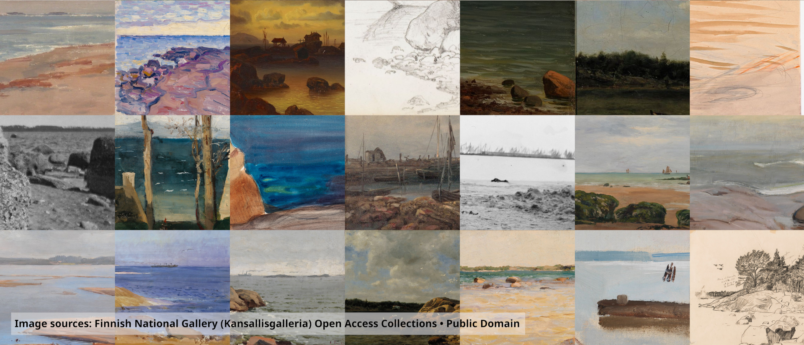

# Computational Approaches to Cultural Heritage Image Collections

A two-hour digital humanities workshop on finding, reading and searching digitised cultural heritage **programmatically**: IIIF, the Europeana API, and searching images by what they look like with CLIP.

## Notebooks

Run them in order, in `notebooks/`, with the `dh-workshop` kernel. Or open them in Google Colab with the buttons (see [SETUP.md](SETUP.md)).

| Notebook | About | Colab |
|---|---|---|
| `01_iiif.ipynb` | IIIF in practice: manifests, image URLs, regions, annotations, viewers |  |
| `02_europeana.ipynb` | Europeana: aggregation, the search API, metadata, finding IIIF manifests |  |
| `03_clip_search.ipynb` | Keyword search against search by embedding, searching with an image, whole image against region |  |
| `0Z_final_task.ipynb` | The final task: what to show and how to hand it in |  |

The helper code is in `notebooks/*.py`. The dataset (about 600,000 open Europeana art images as metadata and CLIP vectors, no images) is **not** in this repository; see [SETUP.md](SETUP.md).

## Other folders

- `colab/`: the same notebooks for Google Colab (made by `scripts/make_colab.py`)
- `scripts/`: how the dataset was built (harvest, images, embeddings), for instructors
- `instructor/`: tools for the instructor
- `misc/`: images used in the notebooks, reference material
- `ARCHIVE/`: earlier and longer versions, kept for a later seminar (not tracked by git)

Sources of all material used: [SOURCES.md](SOURCES.md).
